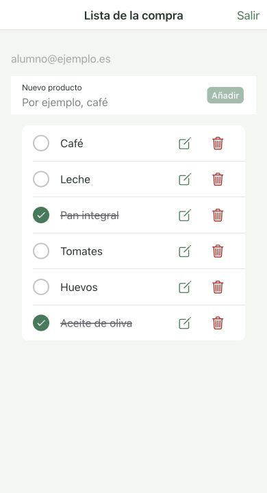
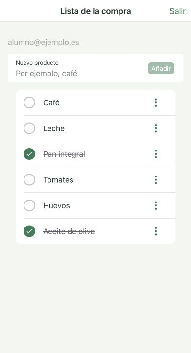
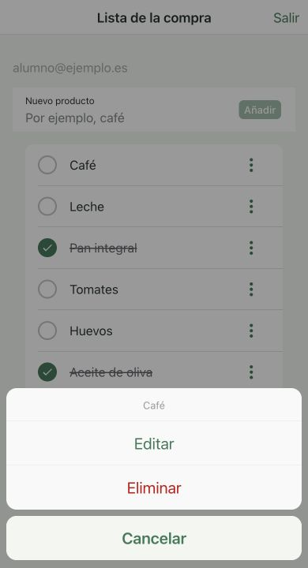
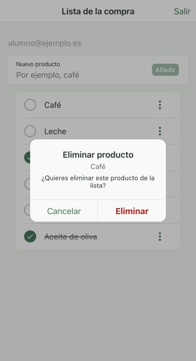
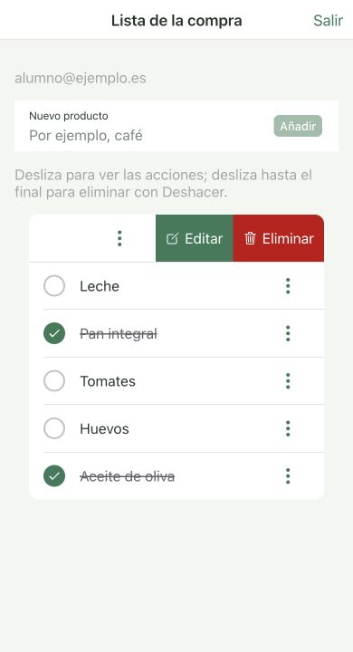
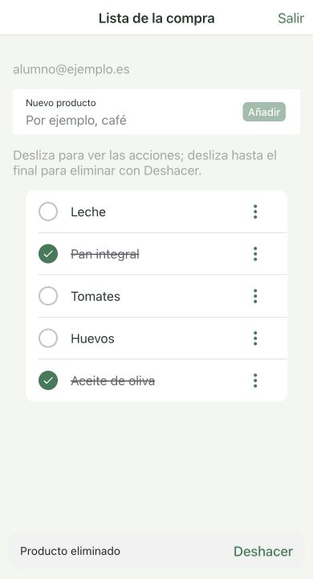
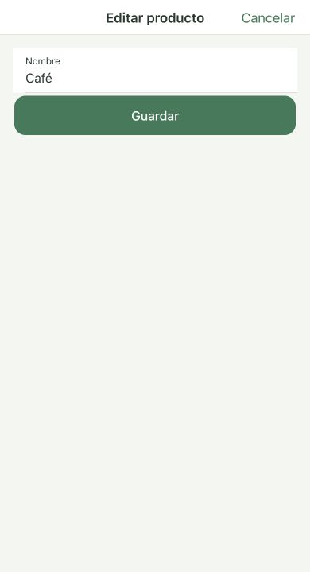
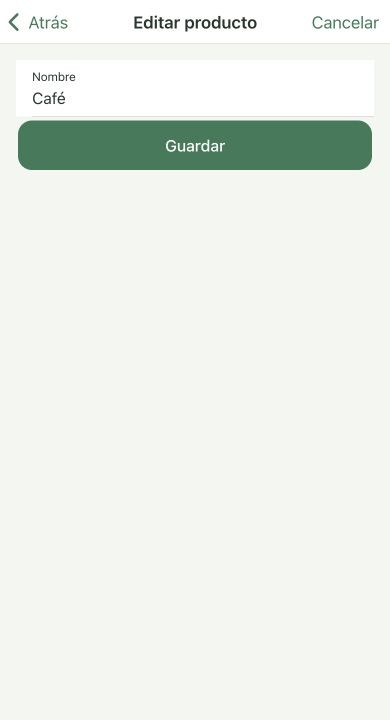

# Interfaces móviles con Ionic

**ADI · Lista de la compra · Guía comparativa**

Una misma operación puede ofrecerse mediante botones, menús o gestos. En una lista de la compra, marcar un producto como comprado es la acción más frecuente  y conviene que tenga un acceso directo. Editar y eliminar pueden ocupar un segundo nivel. En este documento se describen brevemente las distintas opciones de interfaz que tendríamos para que el usuario pudiera disparar esas operaciones de editar y eliminar

Las capturas muestran las variantes del taller con datos de ejemplo, a 390 × 720 píxeles y con la apariencia iOS de Ionic. La apariencia puede cambiar según la plataforma.

## 1. Las cuatro variantes de la demo

| Variante | Acceso a editar y eliminar | Dónde se edita | Ventaja principal | Coste o inconveniente |
| --- | --- | --- | --- | --- |
| **Botones visibles** | Lápiz y papelera en cada fila. | Modal. | Las acciones se descubren y ejecutan directamente. | Ocupan espacio y compiten con el nombre del producto. |
| **Menú de acciones** | Botón de tres puntos que abre un panel de acciones. | Modal. | La fila queda despejada y el acceso sigue siendo visible. | Hace falta un toque adicional para elegir la acción. |
| **Swipe** | Deslizar revela los botones; un gesto completo permite borrar. Se mantienen los tres puntos como alternativa. | Modal. | Ofrece un atajo gestual sin llenar la fila de botones. | El gesto puede pasar desapercibido o activarse por error. |
| **Pantalla de edición** | Los mismos botones visibles que en la primera variante. | Otra página, con botón Atrás. | Permite un formulario amplio y enseña la navegación en pila. | Introduce navegación y exige actualizar la lista al regresar. |

**Hay dos decisiones distintas:** cómo acceder a la operación y para el caso de editar, dónde presentar su formulario.

| Botones visibles | Tres puntos por producto |
| :---: | :---: |
|  |  |

### Componentes de Ionic que aparecen

| Elemento de la interfaz | Componentes |
| --- | --- |
| Lista y filas | `IonList`, `IonItem` |
| Comprado o pendiente | `IonCheckbox` |
| Acciones visibles | `IonButtons`, `IonButton`, `IonIcon` |
| Panel para elegir una acción | `IonActionSheet` |
| Confirmación de borrado | `IonAlert` |
| Editor superpuesto | `IonModal` |
| Aviso con Deshacer | `IonToast` |
| Páginas y pila de navegación | `IonPage`, `IonRouterOutlet`, `IonBackButton` |

## 2. Menú de acciones y confirmación

Al pulsar los tres puntos se abre un **action sheet** con las opciones del producto. Elegir «Editar» abre el formulario. Elegir «Eliminar» abre una confirmación.

| Elegir qué hacer | Confirmar la eliminación |
| :---: | :---: |
|  |  |

El panel de acciones y la confirmación tienen funciones diferentes:

| Interfaz | Pregunta que resuelve | Qué contiene |
| --- | --- | --- |
| **Action sheet** | ¿Qué operación quieres hacer con este producto? | Editar, eliminar y cancelar. |
| **Confirmación** | ¿Quieres ejecutar esta operación? | Descripción y botones para confirmar o cancelar. |

La confirmación reduce los borrados accidentales, pero añade una interrupción a cada borrado. Es una decisión de diseño, no un requisito de todos los patrones móviles.

**Un action sheet no es un formulario de edición.** Para un formulario que aparezca desde abajo se usaría un *sheet modal*, una presentación de `IonModal`.

## 3. Deslizar para mostrar acciones o para ejecutarlas

Estos dos comportamientos se parecen visualmente, pero producen resultados distintos.

| Patrón | Qué hace el gesto | Cómo termina la operación |
| --- | --- | --- |
| **Deslizar para revelar** | Aparta la fila y deja visibles «Editar» y «Eliminar». | El usuario toca el botón correspondiente. En esta app, eliminar pide confirmación. |
| **Deslizar completamente para borrar** | Oculta el producto y muestra un aviso con «Deshacer». | El usuario deshace la acción o deja que se confirme el borrado. |

| Deslizar revela los botones | Completar el gesto ofrece Deshacer |
| :---: | :---: |
|  |  |

Ionic proporciona `IonItemSliding`, `IonItemOptions` e `IonItemOption` para las filas deslizantes. Una opción `expandable` y el evento `ionSwipe` permiten implementar la acción de desplazamiento completo.

## 4. Dónde presentar la edición

| Presentación | Cuándo encaja | Aspectos a considerar |
| --- | --- | --- |
| **En la propia fila** | Cambiar un único dato, como el nombre. | El teclado y los controles de guardar y cancelar pueden comprimir la fila. No está implementada en estas ramas. |
| **Modal** | Un formulario breve y una operación puntual. | Hay que gestionar guardar, cancelar y el cierre del modal. |
| **Panel inferior con formulario** | Edición breve conservando parte de la lista a la vista. | Hay que comprobar el espacio disponible cuando aparece el teclado. No está implementado en estas ramas. |
| **Pantalla independiente** | Un formulario amplio o una tarea con varios pasos. | Hay que gestionar la navegación, el retorno y la actualización de los datos. |

| Editor modal | Página de edición independiente |
| :---: | :---: |
|  |  |

En un móvil, un modal puede ocupar toda la pantalla y parecerse a una página. **La diferencia no depende solo de su tamaño:** en este ejemplo el modal mantiene la ruta de la lista, mientras que la página de edición tiene su propia ruta, `/lista/:id/editar`, y participa en la pila de navegación.

### Qué ocurre al volver atrás

Con `IonRouterOutlet`, al abrir el editor la lista se conserva oculta. Al volver, se recupera esa misma instancia.

| Momento | Lista | Editor |
| --- | --- | --- |
| Primera entrada en la lista | Se monta y recibe los eventos de entrada. | Todavía no existe. |
| Abrir la edición | Recibe los eventos de salida y queda oculta; continúa montada. | Se monta y recibe los eventos de entrada. |
| Volver desde edición | Recibe de nuevo los eventos de entrada; **no se repite `onMounted`**. | Se desapila y se desmonta al terminar la transición. |

| Hook en Composition API | Cuándo se utiliza |
| --- | --- |
| `onMounted` | Cuando se monta una nueva instancia del componente. |
| `onIonViewWillEnter` | Cada vez que la página va a entrar en pantalla, antes de su transición de entrada. |
| `onIonViewDidEnter` | Cuando termina la transición de entrada. |
| `onUnmounted` | Cuando se desmonta la instancia del componente. |

En la variante de la demo, la lista recarga los productos en `onIonViewWillEnter`. Así recoge los cambios guardados en la otra página. Con un estado reactivo compartido que ya se actualizase al guardar, esa recarga podría ser innecesaria.

Al guardar se vuelve atrás: hacer un nuevo `push('/lista')` añadiría otra entrada al historial.

## 5. Otras opciones para comparar

Estas alternativas **no están implementadas en las cuatro ramas**.

| Alternativa | Ventaja | Coste |
| --- | --- | --- |
| **Tocar el nombre para editar** | Acceso directo sin un lápiz adicional. | Hay que distinguir claramente la zona del checkbox de la zona que abre la edición. |
| **Menú junto al botón con un popover** | Mantiene las opciones cerca del producto. | El menú necesita espacio y una posición adecuada. Ionic ofrece `IonPopover`. |
| **Pulsación larga** | Permite abrir acciones contextuales o iniciar una selección. | Es poco descubrible; conviene ofrecer un acceso visible alternativo. |
| **Modo de selección múltiple** | Permite eliminar varios productos de una vez. | Añade otro estado a la interfaz y puede resultar excesivo para una lista sencilla. |

## 6. Qué opción elegir

No hay un único patrón «correcto» para móvil. Para esta app:

- Mantener **comprado o pendiente** como acción directa y visible.
- Usar botones si interesa que todas las operaciones se descubran inmediatamente.
- Usar tres puntos si se quiere despejar la fila.
- Ofrecer swipe como atajo, manteniendo una alternativa visible.
- Elegir modal o página según la tarea y el tamaño del formulario.
- Decidir cómo recuperarse de un borrado accidental: confirmación, Deshacer u otra estrategia adecuada.

Los botones visibles también son una solución válida en móvil: necesitan superficies cómodas de pulsar y suficiente separación.

## 7. Referencias del repositorio

| Referencia de Git | Contenido |
| --- | --- |
| `00-desktop` | Aplicación original de escritorio. |
| `01-ionic-shell` | Navegación y páginas Ionic que todavía envuelven los componentes de escritorio. |
| `02-ionic-base` | Controles Ionic; editar y borrar quedan como ejercicio. |
| `variante/botones` | Botones visibles y editor modal. |
| `variante/action-sheet` | Tres puntos, panel de acciones y editor modal. |
| `03-swipe-revelar` | Paso de la rama swipe que solo revela los botones. |
| `variante/swipe` | Incluye además el gesto completo y Deshacer. |
| `variante/pantalla-edicion` | Editor en otra ruta y hooks de ciclo de vida explícitos. |

## Documentación

- [Filas deslizantes](https://ionicframework.com/docs/api/item-sliding)
- [Panel de acciones](https://ionicframework.com/docs/api/action-sheet)
- [Modales](https://ionicframework.com/docs/api/modal)
- [Navegación con Ionic Vue](https://ionicframework.com/docs/vue/navigation)
- [Ciclo de vida de las páginas](https://ionicframework.com/docs/vue/lifecycle)
