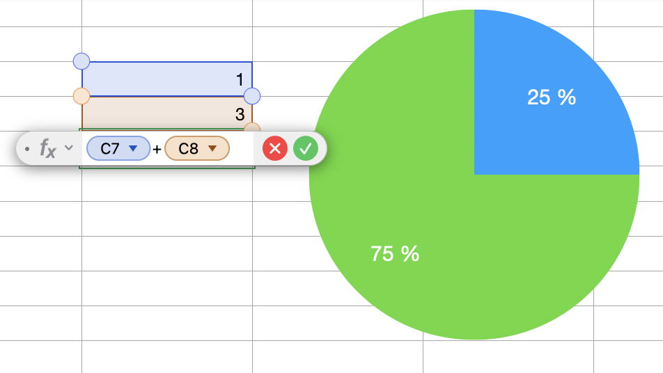
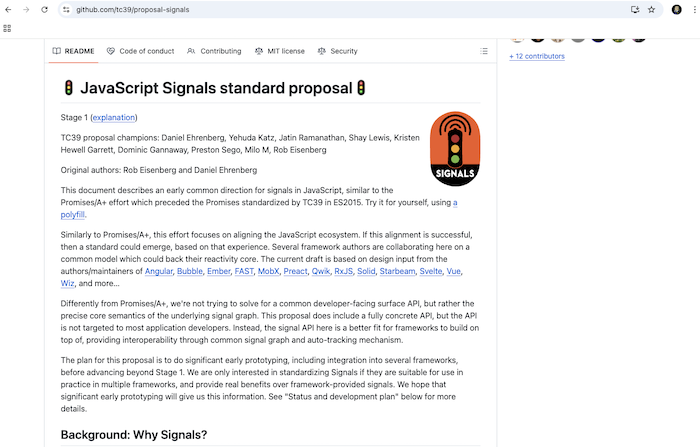
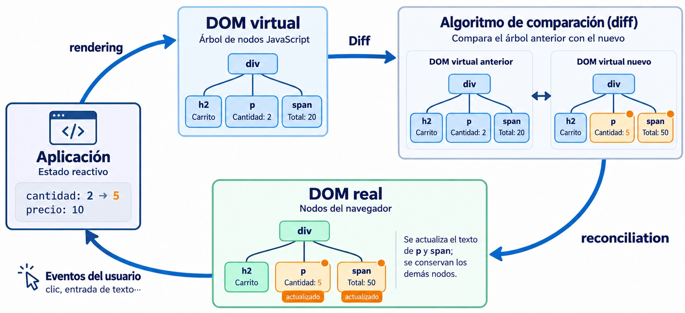
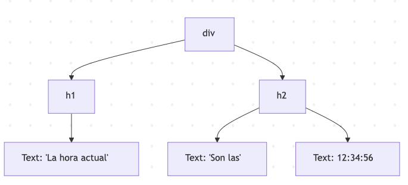

<!-- layout: title-left -->
# Tema 7
# Reactividad en *frameworks* JS

---

Recordemos que prácticamente todos los *frameworks JS* actuales tienen características similares:

- Basados en la idea de **componentes** *anidables*
- Implementan **routing** (*)
- Ofrecen mecanismos de **gestión del estado** (los datos que no son propios de los componentes) (*)
- **Automatizan el *rendering* de HTML (gracias a la **reactividad**)**

(*) Algunos *frameworks* tienen esto integrado, en otros son *plugins*

---

<!-- layout: section-break -->
## 7.1 ¿Qué es la reactividad?

---

En el contexto de los *frameworks* JS:

> **Reactividad**: mantener sincronizados automáticamente los **valores derivados** con el **estado** del que dependen, sin que el programador tenga que propagar los cambios a mano

La **vista también es un valor derivado**: `UI = f(estado)`. Repintar la interfaz cuando cambian los datos es un caso particular de lo mismo.

---

## Ojo con el término

Si buscáis "programación reactiva" vais a encontrar cosas distintas a lo que vemos aquí:

- **Streams / observables** (RxJS): operar sobre secuencias de eventos en el tiempo
- **Reactive Manifesto**: arquitectura de sistemas distribuidos
- **FRP** (programación funcional reactiva): el origen académico (Elliott y Hudak, 1997)

En este tema, *reactividad* = mantener derivados (incluida la vista) sincronizados con el estado

---

<!-- img-align: center -->
En realidad la reactividad no es nada nuevo




---

Como ya sabíais, Javascript no es reactivo:

```javascript
let cantidad = 2
let precio = 10
let total = cantidad * precio
console.log(total)  //20
cantidad = 5
console.log(total)  //no es 50, sigue siendo 20 😕
```

Los *frameworks* hacen que lo sea....hasta cierto punto (¡no pueden cambiar el lenguaje!)

---

## Fuentes, derivados y efectos

Un sistema reactivo es un **grafo de dependencias**: cuando cambia una fuente, se recalcula lo que depende de ella

<svg class="grafo-reactivo" viewBox="0 0 1160 360" role="img" aria-label="Grafo reactivo: las fuentes cantidad y precio alimentan el derivado total, que alimenta un efecto que imprime en la consola" style="width:100%;height:auto;display:block;margin:0.4em auto 0">
<defs>
<marker id="flecha" viewBox="0 0 10 10" refX="9" refY="5" markerWidth="7" markerHeight="7" orient="auto-start-reverse"><path d="M0,0 L10,5 L0,10 z" style="fill:var(--colloquium-link)"/></marker>
</defs>
<g style="font-family:var(--colloquium-font-body);font-size:20px;font-weight:600;letter-spacing:0.08em;fill:var(--colloquium-muted)" text-anchor="middle">
<text x="160" y="34">FUENTES</text>
<text x="570" y="34">DERIVADOS</text>
<text x="975" y="34">EFECTOS</text>
</g>
<g style="stroke:var(--colloquium-link);stroke-width:3;fill:none">
<path d="M290,112 C340,112 340,160 382,166" marker-end="url(#flecha)"/>
<path d="M290,252 C340,252 340,204 382,198" marker-end="url(#flecha)"/>
<path d="M760,182 L822,182" marker-end="url(#flecha)"/>
</g>
<g style="font-family:var(--colloquium-font-mono);font-size:24px" text-anchor="middle" dominant-baseline="central">
<rect x="30" y="80" width="260" height="64" rx="32" style="fill:var(--colloquium-bg);stroke:var(--colloquium-accent);stroke-width:3"/>
<text x="160" y="112" style="fill:var(--colloquium-accent)">cantidad = 2</text>
<rect x="30" y="220" width="260" height="64" rx="32" style="fill:var(--colloquium-bg);stroke:var(--colloquium-accent);stroke-width:3"/>
<text x="160" y="252" style="fill:var(--colloquium-accent)">precio = 10</text>
<rect x="385" y="140" width="370" height="84" rx="10" style="fill:var(--colloquium-code-bg);stroke:var(--colloquium-accent);stroke-width:3"/>
<text x="570" y="182" style="fill:var(--colloquium-text)">cantidad * precio</text>
<text x="570" y="122" style="font-size:20px;fill:var(--colloquium-muted)">total</text>
<polygon points="855,140 1095,140 1130,182 1095,224 855,224 820,182" style="fill:var(--colloquium-accent)"/>
<text x="975" y="182" style="fill:#fff">console.log(total)</text>
</g>
<g style="font-family:var(--colloquium-font-body);font-size:21px;fill:var(--colloquium-muted)" text-anchor="middle">
<text x="160" y="326">se escriben</text>
<text x="570" y="326">se calculan a partir de otros</text>
<text x="975" y="326">tienen efectos laterales</text>
</g>
</svg>

La **vista** es el **efecto** más importante: pintar en el DOM también es "hacer algo fuera"

<!-- notes: Es la hoja de cálculo otra vez: celdas con datos (fuentes), celdas con fórmula (derivados) y lo que se ve en pantalla (efectos). Si cambiamos precio a 15, total pasa a 30 y el efecto vuelve a imprimir. -->

---

<!-- img-align: center -->
volviendo al ejemplo de la hoja de cálculo


---

## Tres preguntas para clasificar un *framework*

Con respecto a la reactividad

1. **¿Cómo sabe qué recalcular?** *(las aristas del grafo)*
   - No lo sabe: vuelve a ejecutar y compara
   - Lo deduce al compilar
   - Lo rastrea en ejecución (lo más común actualmente)
2. **¿Cuándo propaga los cambios?** *(cuándo se ejecutan los efectos/recalculan derivados)* De inmediato o agrupados (*batching*), ansiosos o perezosos (*eager/lazy*)
3. **¿Con qué granularidad actualiza la UI?** *(ámbito de los efectos que pintan la app)* Árbol de componentes / componente / nodo del DOM


En el tema iremos respondiendo a estas preguntas

---

<!-- layout: section-break -->
## 7.2 ¿Cómo sabemos qué recalcular?

---

## Opción A: no lo sabemos (React)

```javascript
function Carrito() {
  const [cantidad, setCantidad] = useState(2)
  const precio = 10
  const total = cantidad * precio 
  return <button onClick={() => setCantidad(cantidad + 1)}>Cantidad: {cantidad} Total: {total}</button>
}
```

- React **no sabe** que `total` depende de `cantidad`
- Cuando cambia el estado (`setCantidad`), **vuelve a ejecutar la función del componente entera**
- `total` está siempre al día... **porque se recalcula todo**

<span class="text-sm">[El ejemplo online](https://reactplayground.vercel.app/#N4IgLgziBcBmCGAbCBTANCAbrK1QEsA7AExQA8A6AK1xHwFsAHAewCcwACAQUcY9lbN6HAOQUA9D0bUIZEQB1CDFuw4AlFPADGnAUNGtNOhUqZtOwDlsPwwKNc2acAvv0HCRNnQFpiQ8VqI+CiEYCaKWsyEEJyRofBEKKwcALwcfloArvQhYBQA5ihgAKKIKDmhAEIAngCSxAAUno5hAJQRUTEcgk6pVjZ2Dk4NcWAJhEnthD15hiRJDYoc6kZ51pp2peW5i4TLyxraeQDKYKz4OgCyzKRoS-uEmYiId3v7hzoU67YoWxVgDSkU2WU1aIAwUhkZBgdDMqg+YDQHEsmVQpx+HFceg8XjCikUsEyhB0+CiHAAwvBWOcwMwGq1kfc4l0ANpaeChfDEeDEJGoMCUznc4gAXT6qJQ6LsDQATMCrJ1OIxDFpSX0AIwABiZio4tLGiD67KFPI4ACoOMqUKrmBx7oYwJlWHsADwAI0yYFpeyi5KCWgA1ilgPTUgA+Dj8wVgLk8kYcmPCjgAag46tazjD0djxGgyONiZ5rgAKk4kHngPqkM4XeIPV6omHFM58RMyCpOKQEE9OJTqfhaeCQDFqmUvhBaBQ3WA9sB7rAomBvBB8AAvFB5mWGegAbmbIGcziAA)</span>


---

## Opción B: deducirlo al compilar (Svelte 3/4)

- Hasta la versión 4, Svelte analizaba las dependencias **en tiempo de compilación** y generaba directamente el código que actualiza cada parte del DOM
- Mínimo trabajo en *runtime* (aunque sí hay un *runtime* pequeño)
- Limitación: el compilador solo "ve" las dependencias que aparecen literalmente en el código del componente
- [Ejemplo online](https://svelte.dev/playground/a17ccc68af7d44948dee4b68256766dc?version=4.1.0) (mirad la solapa "JS Output")
- Svelte 5 **sigue siendo un compilador**, pero ahora genera código basado en *signals*, con las dependencias rastreadas en ejecución

<!-- notes: - En el JS generado, `p(ctx, dirty)` actualiza solo los nodos que pueden cambiar (`dirty` indica qué variables han cambiado)
- La limitación de la compilación estática es una de las razones del cambio a runes en Svelte 5: con `$state` la reactividad funciona también fuera de los componentes (en ficheros `.svelte.js`) -->


---

<!-- style: --colloquium-code-size: 0.68em -->
<!-- padding: compact -->

## Opción C: rastreamos dependencias en ejecución (Vue, Solid)

```javascript
import { reactive, computed, effect } from 'vue'

const estado = reactive({ cantidad: 2, precio: 10 })

// Derivado: se calcula a partir del estado
const total = computed(() => estado.cantidad * estado.precio)

// Efecto: hace algo "fuera" (aquí, escribir en la consola)
effect(() => console.log('total =', total.value))

estado.cantidad = 5   // -> total = 50
estado.precio = 15    // -> total = 75
```

<span class="text-sm">[El ejemplo online](https://play.vuejs.org/#eNqNU9tuEzEQ/ZXRviStwiZtKUhRU3HrAwgBAsSTJeR6J6mLY2/tcUgV5ZP4Cn6M8Xp3GyIa8baeOTPnzM6ZTfGyrstVxGJaXATldU0QkGJ9Kaxe1s4TbMCjVKRXOALllnUkrEaA8zkqgi3MvVvCgDsMhBVWORsIMJCsHMz6yuEGlLSkK1lN4XQEtUel3RROJrA9SnXjMbxBr1dcNmUBjDYqGgkSaulJe6jQtG07EnIkDXN0mobDI5hdtqCyo4PjLpI5O7arJJ+5bqRCkGbhQBTziF6KAobyLv7+xTOmH3LN5GiBtSRaZyR3yMO3hDmMpXGL4aAVNRhleeVKmohHDem+sBmcAwBLeXLZz3I+6XFZLsdOEmwP9/xc2Itx3hdvih+Ey9pIwvwa989iVFBgiXO9KG+Ds7znjbDA06b/pg36jzVpHkEUU2gyKSeNcT/fNTHyEUddXN2g+vGP+G1Yp5goPnkM6Fcoij5H0i+Qcvrqywdc83efXLoqGkYfSH5G/r0xacywV9FWLHsH16h927hV28XXcLUmtKEbKglNyG2DFwVb9fWB0R/knpVPmzpht/wXU83/H8reebzgwnGb1XS/cyq8bMK/LiVxKhctTWHSSK69VphuhV/5Wgw+2J8ds2fIpgP75T3yHaVGcJ97JAfdRawkhJhGIMf3JZfXMqSKrmGjqMyFx+2rKc/CHjc7S8vydjvM4LR3Lzs6nzUvpSU7Zfk7FK3dH4WfNdMe8D5vcNf9wvLmvlP4hj75gXf3rJyUZ8X2D0s2qDc=)</span>

<!-- notes: - Para comprobar la reactividad más claramente, añadir una línea `setInterval(()=>estado.cantidad++, 1000)` -->

---

## Cómo funciona "por dentro"

- Al **leer** una propiedad dentro de un *effect* → la apuntamos como dependencia (*track*)
- Al **escribir** una propiedad → ejecutamos los *effects* que dependen de ella (*trigger*)
- Vue usa *proxies* ES6: objetos que "envuelven" a otros e interceptan sus **operaciones fundamentales** (leer, escribir, borrar propiedades...)

---

<!-- style: --colloquium-code-size: 0.68em -->
<!-- padding: compact -->
## Un *proxy* que espía

```javascript
const estado = { valor: 1 }
const handler = {
  get(obj, prop, receptor) {
    console.log('leyendo', prop)      // Vue: track(obj, prop)
    return Reflect.get(obj, prop, receptor)
  },
  set(obj, prop, val, receptor) {
    console.log('cambiando', prop, 'a', val)
    const ok = Reflect.set(obj, prop, val, receptor)
                                      // Vue: trigger(obj, prop)
    return ok   // la trampa set DEBE devolver true si ha ido bien
  }
}
const estadoProxy = new Proxy(estado, handler)
estadoProxy.valor = 2
console.log(estadoProxy.valor)
```

<!-- notes: Si la trampa `set` no devuelve `true`, en modo estricto (los módulos ES lo son) se lanza `TypeError: 'set' on proxy: trap returned falsish` -->

---

<!-- padding: compact -->
<!-- style: --colloquium-code-size: 0.66em -->
## Hagámoslo nosotros (1/2): `track`, `trigger`, `reactive`

```javascript
const deps = new WeakMap()   // objeto -> (propiedad -> Set de effects)
let efectoActivo = null

function track(obj, prop) {
  if (!efectoActivo) return
  let depsObj = deps.get(obj)
  if (!depsObj) deps.set(obj, depsObj = new Map())
  let dep = depsObj.get(prop)
  if (!dep) depsObj.set(prop, dep = new Set())
  dep.add(efectoActivo)
}

function trigger(obj, prop) { deps.get(obj)?.get(prop)?.forEach(ef => ef()) }

function reactive(obj) {
  return new Proxy(obj, {
    get(o, p, r) { track(o, p); return Reflect.get(o, p, r) },
    set(o, p, v, r) { const ok = Reflect.set(o, p, v, r); trigger(o, p); return ok }
  })
}
```

---

<!-- padding: compact -->
## Hagámoslo nosotros (2/2): `effect` y `computed`

```javascript
function effect(fn) {
  const ef = () => { const prev = efectoActivo; efectoActivo = ef; fn(); efectoActivo = prev}
  ef()
}

export function computed(fn) {
  const r = reactive({ value: undefined })
  let creado = false
  return {
    get value() {
      if (!creado) { creado = true; effect(() => { r.value = fn() }) }
      return r.value
    }
  }
}
```


<!-- notes: - Ideal para hacerlo en directo y probarlo con el ejemplo de `cantidad` y `precio`
- Simplificaciones respecto a Vue: no soporta effects anidados, no limpia dependencias que dejan de usarse, no agrupa actualizaciones
- Pregunta para clase: ¿qué pasa si dentro de un effect hay un `if` y una rama deja de leer una propiedad? (respuesta: el effect sigue suscrito a ella → ejecuciones de más; por eso Vue limpia y reconstruye dependencias en cada ejecución) -->

---

<!-- columns: 55/45 -->
## Rastrear sin *proxies*: *signals* (SolidJS)

El *framework* SolidJS usa **signals** y **effects**, ideas muy similares a las de Vue

```javascript
import { createSignal, createEffect } from "solid-js";

const [valor, setValor] = createSignal(1);
createEffect(() => console.log("valor", valor()));

setValor(valor()+1)
```

<span class="text-sm">[El ejemplo online](https://playground.solidjs.com/anonymous/fec3a75f-4fac-4ae8-8b80-849dafc7e94f)</span>

|||

`valor()` es una **función** para que el *framework* pueda interceptar la operación de "leer valor" (ahí se hace el *track*).
<!-- notes: Para comprobar la reactividad más claramente, añadir una línea `setInterval(()=>setValor(valor()+1), 1000)` -->

---

## Signals, signals everywhere

En los últimos años **las *signals* se han convertido en la primitiva de moda para la reactividad** y se han incorporado a *frameworks* ya existentes como Angular, Preact o Svelte

En Svelte 5 la sintaxis son las [*runes*](https://svelte.dev/blog/runes) (directivas para el compilador), por debajo hay *signals*

```svelte
<script>
    let count = $state(0);
    let doubled = $derived(count * 2);
</script>
<h1>Contador: {count}</h1>
<h1>Doble: {doubled}</h1>
<button onclick={()=>count++}>Incrementar</button>
```

<span class="text-sm">[Ejemplo online](https://svelte.dev/playground/d594d05ff4f448d7b56ebb403dfbe5d1?version=5.1.3)</span>

---

<!-- img-align: center -->
## ¿Signals en el estándar?

- Hay una [propuesta](https://github.com/tc39/proposal-signals) para estandarizar las *signals* en Javascript, con participación de autores de Angular, Preact, Solid, Svelte, Vue...
- La idea no es que las usemos directamente, sino ofrecer una base común sobre la que construyan los *frameworks*



<!-- notes: Comprobar el stage actual en el repositorio antes de clase (la captura muestra Stage 1) -->

---

<!-- padding: compact -->
## Cada *framework* llama a los efectos de una manera

```javascript
// Vue: rastreo automático...
watchEffect(() => console.log(count.value))

// Svelte 5
$effect(() => console.log(count))

// SolidJS
createEffect(() => console.log(count()))

// Preact signals
effect(() => console.log(count.value))
```

- Con dos cambios seguidos (`count` = 1 y luego 2), Vue y Svelte **agrupan**: el efecto ve 0 y 2. Solid lo ejecuta **al momento**: 0, 1 y 2
- **El efecto que más se usa es el que pinta cada componente, y ese lo crea el framework**. Los nuestros son para hablar con lo que no es reactivo: localStorage, librerías externas, temporizadores…

<!-- notes: Comprobado ejecutándolo (Vue 3.5, Svelte 5.57, Solid 1.9, Preact signals 1.14) con count = 1; count = 2 seguidos: watchEffect y $effect se ejecutan una vez al crearlos (0) y otra antes del siguiente render (2); createEffect y effect de Preact, tres veces (0, 1, 2); watch, una sola vez con 0 → 2. En Vue también existe effect (de @vue/reactivity), la primitiva síncrona que usamos en los ejemplos: no agrupa ni se para al desmontar el componente, y en código de aplicación se usa watchEffect o watch. En React el equivalente es useEffect(fn, [count]): dependencias declaradas a mano y se ejecuta después de pintar. -->

---

<!-- padding: compact -->
## Y Cada *framework* llama a los derivados de una manera

```javascript
// Vue
const doble = computed(() => count.value * 2)

// Svelte 5
let doble = $derived(count * 2)

// SolidJS
const doble = createMemo(() => count() * 2)

// React: no hace falta (se recalcula en cada render)...
const doble = count * 2
// ...salvo que sea costoso: lo memoizamos
const resultado = useMemo(() => calculoCaro(count), [count])
```

---

## ¿Derivado o efecto?

| | Derivado | Efecto |
|---|---|---|
| **Qué hace** | Calcula y **devuelve un valor** | Hace algo **fuera** del grafo |
| **Debe ser** | Puro, sin efectos secundarios | Justo lo contrario |
| **Cuándo se ejecuta** | Cuando alguien lo lee (perezoso)* | Siempre que cambia una dependencia |
| **¿Cachea?** | Sí | No tiene nada que cachear |

Regla práctica: si lo que haces es **calcular un valor**, es un derivado. Si para "calcularlo" necesitas asignar a otra variable dentro de un efecto, algo va mal.

<span class="text-sm">* Salvo en SolidJS, donde `createMemo` es ansioso</span>


---

<!-- layout: section-break -->
## 7.3 ¿Cuándo se propagan los cambios?


---

## Derivados perezosos y Efectos ansiosos (!)

- Derivados
  - En Vue, Svelte y Preact los derivados son **perezosos** *(lazy)* y **cacheados**: no se recalculan hasta que alguien los lee y algo ha cambiado
  - SolidJS es la excepción: `createMemo` es **ansioso** *(eager)* (se recalcula en cuanto cambia una dependencia, aunque nadie lo lea)
  - En React las dependencias de `useMemo` las declaramos **a mano**
- Efectos:
  - Un efecto no lo lee nadie. Si fueran perezosos, no se ejecutarían nunca. Por eso, cuando cambia algo de lo que dependen, se programan para ejecutarse sí o sí.

---

<!-- columns: 60/40 -->
## El problema del diamante

```javascript
import { reactive, effect, computed } from 'vue'

const estado = reactive({ a: 1 })
const b = computed(() => estado.a * 2)
const c = computed(() => estado.a + b.value)

effect(() => console.log('c =', c.value))
estado.a = 2
```

`c` depende de `a` **por dos caminos**

¿Qué se imprime ahora? ¿`c = 4` (con `b` todavía antiguo) y luego `c = 6`? ¿O solo `c = 6`?

|||

<svg class="grafo-diamante-v" viewBox="0 0 470 500" role="img" aria-label="Grafo en diamante en vertical: a alimenta a b y a c, b alimenta a c, y c alimenta un efecto que imprime en la consola" style="width:100%;height:auto;display:block;margin:0 auto">
<defs>
<marker id="flecha-dv" viewBox="0 0 10 10" refX="9" refY="5" markerWidth="7" markerHeight="7" orient="auto-start-reverse"><path d="M0,0 L10,5 L0,10 z" style="fill:var(--colloquium-link)"/></marker>
</defs>
<g style="stroke:var(--colloquium-link);stroke-width:3;fill:none">
<path d="M190,62 C150,90 120,100 112,130" marker-end="url(#flecha-dv)"/>
<path d="M200,190 C260,200 300,220 318,256" marker-end="url(#flecha-dv)"/>
<path d="M280,62 C350,100 380,180 350,256" marker-end="url(#flecha-dv)"/>
<path d="M330,320 L330,370" marker-end="url(#flecha-dv)"/>
</g>
<g style="font-family:var(--colloquium-font-mono);font-size:24px" text-anchor="middle" dominant-baseline="central">
<rect x="125" y="6" width="200" height="56" rx="28" style="fill:var(--colloquium-bg);stroke:var(--colloquium-accent);stroke-width:3"/>
<text x="225" y="34" style="fill:var(--colloquium-accent)">a = 1</text>
<rect x="20" y="134" width="180" height="60" rx="10" style="fill:var(--colloquium-code-bg);stroke:var(--colloquium-accent);stroke-width:3"/>
<text x="110" y="164" style="fill:var(--colloquium-text)">a * 2</text>
<text x="225" y="164" style="font-size:22px;fill:var(--colloquium-muted)">b</text>
<rect x="240" y="260" width="180" height="60" rx="10" style="fill:var(--colloquium-code-bg);stroke:var(--colloquium-accent);stroke-width:3"/>
<text x="330" y="290" style="fill:var(--colloquium-text)">a + b</text>
<text x="215" y="290" style="font-size:22px;fill:var(--colloquium-muted)">c</text>
<polygon points="225,374 435,374 465,414 435,454 225,454 195,414" style="fill:var(--colloquium-accent)"/>
<text x="330" y="414" style="fill:#fff">console.log(c)</text>
</g>
</svg>

<!-- notes: Primero que lo predigan: la respuesta la dan las dos traspas siguientes, paso a paso. Vue imprime solo c = 6 (comprobado ejecutándolo; lo mismo en Svelte 5, Solid y Preact). Una implementación ingenua, como nuestra versión de 25 líneas con derivados hechos con effects, puede imprimir c = 4 y luego c = 6. -->

---

## El diamante con propagación ingenua

<svg class="diamante-pasos" viewBox="0 0 1160 420" role="img" aria-label="Diamante con propagación ingenua, paso a paso" style="width:100%;height:auto;display:block;margin:0.2em auto 0">
<defs>
<marker id="dn-off" viewBox="0 0 10 10" refX="9" refY="5" markerWidth="7" markerHeight="7" orient="auto-start-reverse"><path d="M0,0 L10,5 L0,10 z" style="fill:var(--colloquium-muted);fill-opacity:0.6"/></marker>
<marker id="dn-on" viewBox="0 0 10 10" refX="8" refY="5" markerWidth="5" markerHeight="5" orient="auto-start-reverse"><path d="M0,0 L10,5 L0,10 z" style="fill:var(--colloquium-link)"/></marker>
</defs>
<path d="M262,188 C320,150 330,118 386,116" style="stroke:var(--colloquium-muted);stroke-opacity:0.45;stroke-width:3;fill:none" marker-end="url(#dn-off)"/>
<path d="M574,116 C640,116 660,150 688,186" style="stroke:var(--colloquium-muted);stroke-opacity:0.45;stroke-width:3;fill:none" marker-end="url(#dn-off)"/>
<path d="M262,218 C380,320 560,320 688,236" style="stroke:var(--colloquium-muted);stroke-opacity:0.45;stroke-width:3;fill:none" marker-end="url(#dn-off)"/>
<path d="M870,212 L912,212" style="stroke:var(--colloquium-muted);stroke-opacity:0.45;stroke-width:3;fill:none" marker-end="url(#dn-off)"/>
<rect x="40" y="180" width="220" height="64" rx="32" style="fill:var(--colloquium-bg);stroke:var(--colloquium-accent);stroke-width:3"/><text x="150" y="212" text-anchor="middle" dominant-baseline="central" style="font-family:var(--colloquium-font-mono);font-size:24px;fill:var(--colloquium-accent);">a = 1</text>
<rect x="390" y="84" width="180" height="64" rx="10" style="fill:var(--colloquium-code-bg);stroke:var(--colloquium-accent);stroke-width:3"/>
<text x="480" y="116" text-anchor="middle" dominant-baseline="central" style="font-family:var(--colloquium-font-mono);font-size:24px;fill:var(--colloquium-text)">a * 2</text>
<text x="480" y="66" text-anchor="middle" style="font-family:var(--colloquium-font-mono);font-size:20px;fill:var(--colloquium-muted)">b</text>
<rect x="690" y="180" width="180" height="64" rx="10" style="fill:var(--colloquium-code-bg);stroke:var(--colloquium-accent);stroke-width:3"/>
<text x="780" y="212" text-anchor="middle" dominant-baseline="central" style="font-family:var(--colloquium-font-mono);font-size:24px;fill:var(--colloquium-text)">a + b</text>
<text x="780" y="162" text-anchor="middle" style="font-family:var(--colloquium-font-mono);font-size:20px;fill:var(--colloquium-muted)">c</text>
<polygon points="945,170 1110,170 1145,212 1110,254 945,254 915,212" style="fill:var(--colloquium-accent)"/>
<text x="1030" y="212" text-anchor="middle" dominant-baseline="central" style="font-family:var(--colloquium-font-mono);font-size:24px;fill:#fff">console.log(c)</text>
<rect x="425.0" y="163" width="110" height="34" rx="17" style="fill:var(--colloquium-bg);stroke:var(--colloquium-accent);stroke-width:2.5;"/><text x="480" y="180" text-anchor="middle" dominant-baseline="central" style="font-family:var(--colloquium-font-mono);font-size:21px;fill:var(--colloquium-text);">b = 2</text>
<rect x="725.0" y="259" width="110" height="34" rx="17" style="fill:var(--colloquium-bg);stroke:var(--colloquium-accent);stroke-width:2.5;"/><text x="780" y="276" text-anchor="middle" dominant-baseline="central" style="font-family:var(--colloquium-font-mono);font-size:21px;fill:var(--colloquium-text);">c = 3</text>
<rect x="915" y="282" width="230" height="72" rx="8" style="fill:#1e1e24"/>
<text x="927" y="296" style="font-family:var(--colloquium-font-mono);font-size:14px;fill:#9ca3af">consola</text>
<text x="955" y="318" text-anchor="middle" dominant-baseline="central" style="font-family:var(--colloquium-font-mono);font-size:26px;fill:#e5e7eb">3</text>
<rect x="0" y="366" width="1160" height="54" style="fill:var(--colloquium-bg)"/><text x="0" y="393" dominant-baseline="central" style="font-family:var(--colloquium-font-body);font-size:25px;fill:var(--colloquium-text)">Estado inicial: <tspan style="font-weight:600">a = 1, b = 2, c = 3</tspan>. Ahora hacemos a = 2 (clic para avanzar)</text>
<g class="fragment" data-colloquium-fragment="1"><rect x="40" y="180" width="220" height="64" rx="32" style="fill:var(--colloquium-bg);stroke:var(--colloquium-link);stroke-width:4"/><text x="150" y="212" text-anchor="middle" dominant-baseline="central" style="font-family:var(--colloquium-font-mono);font-size:24px;fill:var(--colloquium-link);font-weight:700;">a = 2</text><path d="M262,218 C380,320 560,320 688,236" style="stroke:var(--colloquium-link);stroke-width:5;fill:none" marker-end="url(#dn-on)"/><rect x="0" y="366" width="1160" height="54" style="fill:var(--colloquium-bg)"/><text x="0" y="393" dominant-baseline="central" style="font-family:var(--colloquium-font-body);font-size:25px;fill:var(--colloquium-text)">1. Con <tspan style="font-weight:600">computed perezoso</tspan>, c se suscribió a a antes que b: a avisa primero a c</text></g>
<g class="fragment" data-colloquium-fragment="1"><rect x="725.0" y="259" width="110" height="34" rx="17" style="fill:#fde4dc;stroke:var(--colloquium-link);stroke-width:2.5;"/><text x="780" y="276" text-anchor="middle" dominant-baseline="central" style="font-family:var(--colloquium-font-mono);font-size:21px;fill:var(--colloquium-link);font-weight:700;">c = 4</text><rect x="0" y="366" width="1160" height="54" style="fill:var(--colloquium-bg)"/><text x="0" y="393" dominant-baseline="central" style="font-family:var(--colloquium-font-body);font-size:25px;fill:var(--colloquium-text)">2. c se recalcula: a + b = 2 + <tspan style="font-weight:600">2</tspan> = 4. ¡b todavía no se ha enterado!</text></g>
<g class="fragment" data-colloquium-fragment="1"><path d="M870,212 L912,212" style="stroke:var(--colloquium-link);stroke-width:5;fill:none" marker-end="url(#dn-on)"/><text x="990" y="318" text-anchor="middle" dominant-baseline="central" style="font-family:var(--colloquium-font-mono);font-size:20px;fill:#9ca3af">→</text><text x="1025" y="318" text-anchor="middle" dominant-baseline="central" style="font-family:var(--colloquium-font-mono);font-size:26px;font-weight:700;fill:#ff8a73">4</text><rect x="0" y="366" width="1160" height="54" style="fill:var(--colloquium-bg)"/><text x="0" y="393" dominant-baseline="central" style="font-family:var(--colloquium-font-body);font-size:25px;fill:var(--colloquium-text)">3. c ha cambiado: el efecto muestra <tspan style="font-weight:600">4</tspan>, un valor imposible. Es el <tspan style="font-weight:600">glitch</tspan></text></g>
<g class="fragment" data-colloquium-fragment="1"><path d="M262,188 C320,150 330,118 386,116" style="stroke:var(--colloquium-link);stroke-width:5;fill:none" marker-end="url(#dn-on)"/><rect x="425.0" y="163" width="110" height="34" rx="17" style="fill:var(--colloquium-bg);stroke:var(--colloquium-accent);stroke-width:2.5;"/><text x="480" y="180" text-anchor="middle" dominant-baseline="central" style="font-family:var(--colloquium-font-mono);font-size:21px;fill:var(--colloquium-accent);font-weight:700;">b = 4</text><rect x="0" y="366" width="1160" height="54" style="fill:var(--colloquium-bg)"/><text x="0" y="393" dominant-baseline="central" style="font-family:var(--colloquium-font-body);font-size:25px;fill:var(--colloquium-text)">4. Ahora a avisa a b: b = 2 × 2 = 4</text></g>
<g class="fragment" data-colloquium-fragment="1"><path d="M574,116 C640,116 660,150 688,186" style="stroke:var(--colloquium-link);stroke-width:5;fill:none" marker-end="url(#dn-on)"/><rect x="725.0" y="259" width="110" height="34" rx="17" style="fill:var(--colloquium-bg);stroke:var(--colloquium-accent);stroke-width:2.5;"/><text x="780" y="276" text-anchor="middle" dominant-baseline="central" style="font-family:var(--colloquium-font-mono);font-size:21px;fill:var(--colloquium-accent);font-weight:700;">c = 6</text><text x="1060" y="318" text-anchor="middle" dominant-baseline="central" style="font-family:var(--colloquium-font-mono);font-size:20px;fill:#9ca3af">→</text><text x="1095" y="318" text-anchor="middle" dominant-baseline="central" style="font-family:var(--colloquium-font-mono);font-size:26px;font-weight:700;fill:#7dd3c0">6</text><rect x="0" y="366" width="1160" height="54" style="fill:var(--colloquium-bg)"/><text x="0" y="393" dominant-baseline="central" style="font-family:var(--colloquium-font-body);font-size:25px;fill:var(--colloquium-text)">5. b avisa a c: c = 2 + 4 = 6, y el efecto muestra 6. La consola vio <tspan style="font-weight:600">3 → 4 → 6</tspan></text></g>
<g class="fragment" data-colloquium-fragment="1"><rect x="0" y="366" width="1160" height="54" style="fill:var(--colloquium-bg)"/><text x="0" y="393" dominant-baseline="central" style="font-family:var(--colloquium-font-body);font-size:25px;fill:var(--colloquium-text)">Perezoso: <tspan style="font-weight:600">3 → 4 → 6</tspan> (glitch). Ansioso, con b suscrito primero: <tspan style="font-weight:600">3 → 6 → 6</tspan> (trabajo repetido)</text></g>
</svg>

[La demo online con versión ingenua](https://runjs.app/play?s=PTAECUFMEMGMBcCWA3RATabQCI2VAFYCuA5kZPJNgFygA20oiAtgA52TOQB28ciAZ+6g8oAEwBWegFvuMAM6gA1KFgB7NkUpoAUOu7z4IyK0UBeUHIDuoAOowA1gFlorABQBKUN5Cg1AIwIKNVAAWgA+UDdWACc1VkRIDCwI0ABlCmNQSAAzHMgEeQ8dDiNcgvg1AEEEFBCLbiI6Oh0dHKJuWrVheBi4BzcAggAaUFj4rwBvHW9EHKiAQnKEatrkNS8YiiIY7hn6TLxTAHlA0Asj+QA6EgpBwOLZ+bcFy9OCL0ur+Tuh0bezg1IDYXO4PI8DkYjudjCdAjc7uNWBC5osjp8TPJ3t9EXFWP8TDDrOk7uD9kcrpg0G5lpUakh1sUAL6tdqdJDdUC9RAkW4xe4jMZ4qbkzEI+ACjwAfnF0WFMpyahiAFE4AALGnzMyRXKeZmsjpdYRbOAMyCS0DTbxbeA7YTEgAKcQAHgBPAWjK3eUC3CVqUb40AxKZcvqwAb+sYeADcQe2uwguQ4CFlkcDwdATOG+28Pz9AdGyFGGcmqm6hj8DhhUByyfgOPzY0LxZjoZ5fMGAdbNrtlcz+yZ+raho5wly+QQbhy3BFPjAAHEiNAYhhmGpFJA6Nk8hVQNBeJAYoglWNl4wAI7kUBs2DHuTCOjr7cT+CKffoTDr-b6Cu5GGec5IlLH8jFiSBkBhWlVgZNRYyg+k6kgnJY2nTw4JfaDEIsMCIJZbxdSHXx1E0bRQAdZVwGVAAtY40mOWgflUaA6FgJpGAYIUWEPRhkEgAAvUBL3wZiyESB8Qg4SBh3ZO8yxIpIpxnS1v3LIwYhhE01nNUtkGY8haA6PAckQOQsEHfZSlUE00Hqa9mJ+fYewTL1vF9UBdLocgAJc71UReWBrI2S0rJgGyYV6ch0JfNwAO1YKYiuDyrwsVCvEHftvW9JzjUSvSpMyvD+xZVo9FU7JDE-DSYC0txS2gWgAEZM2KEDQH8GFiNYLQFNinUKpsylQAAKnEFqytgDqNC67QYq8OLIH6tRBpUfxcs8yBih0ccKlmwCywMNQOCuR8SDcAByCazDO0ZYDW8gyQWvgBsYCwxCAA)

<!-- notes: "Ingenua" = avisar a los dependientes en el orden en que se suscribieron y recalcular en el acto. El orden de suscripción no es el del código, sino el orden en que cada derivado se evalúa por primera vez. Con un computed perezoso (se calcula la primera vez que se lee), el effect pide c, c lee a (se suscribe) y solo entonces pide b, que se evalúa y se suscribe a a en segundo lugar: por eso a avisa primero a c y sale el glitch 3 → 4 → 6. Con un computed ansioso (se calcula al crearlo), b se crea y se suscribe primero: a avisa a b (b = 4), b avisa a c (c = 6, el efecto muestra 6) y luego a avisa a c por el camino directo (c = 6 otra vez, el efecto se ejecuta otra vez): 3 → 6 → 6. Moraleja: la propagación ingenua falla siempre, solo cambia cómo. Demo: el mismo programa con las dos versiones de computed de la implementación de 25 líneas y con Vue (carpeta demo-diamante). Las tres salidas, comprobadas ejecutándolas. -->

---

## El diamante con *push-pull*

<svg class="diamante-pasos" viewBox="0 0 1160 420" role="img" aria-label="Diamante con push-pull, paso a paso" style="width:100%;height:auto;display:block;margin:0.2em auto 0">
<defs>
<marker id="dp-off" viewBox="0 0 10 10" refX="9" refY="5" markerWidth="7" markerHeight="7" orient="auto-start-reverse"><path d="M0,0 L10,5 L0,10 z" style="fill:var(--colloquium-muted);fill-opacity:0.6"/></marker>
<marker id="dp-on" viewBox="0 0 10 10" refX="8" refY="5" markerWidth="5" markerHeight="5" orient="auto-start-reverse"><path d="M0,0 L10,5 L0,10 z" style="fill:var(--colloquium-link)"/></marker>
</defs>
<path d="M262,188 C320,150 330,118 386,116" style="stroke:var(--colloquium-muted);stroke-opacity:0.45;stroke-width:3;fill:none" marker-end="url(#dp-off)"/>
<path d="M574,116 C640,116 660,150 688,186" style="stroke:var(--colloquium-muted);stroke-opacity:0.45;stroke-width:3;fill:none" marker-end="url(#dp-off)"/>
<path d="M262,218 C380,320 560,320 688,236" style="stroke:var(--colloquium-muted);stroke-opacity:0.45;stroke-width:3;fill:none" marker-end="url(#dp-off)"/>
<path d="M870,212 L912,212" style="stroke:var(--colloquium-muted);stroke-opacity:0.45;stroke-width:3;fill:none" marker-end="url(#dp-off)"/>
<rect x="40" y="180" width="220" height="64" rx="32" style="fill:var(--colloquium-bg);stroke:var(--colloquium-accent);stroke-width:3"/><text x="150" y="212" text-anchor="middle" dominant-baseline="central" style="font-family:var(--colloquium-font-mono);font-size:24px;fill:var(--colloquium-accent);">a = 1</text>
<rect x="390" y="84" width="180" height="64" rx="10" style="fill:var(--colloquium-code-bg);stroke:var(--colloquium-accent);stroke-width:3"/>
<text x="480" y="116" text-anchor="middle" dominant-baseline="central" style="font-family:var(--colloquium-font-mono);font-size:24px;fill:var(--colloquium-text)">a * 2</text>
<text x="480" y="66" text-anchor="middle" style="font-family:var(--colloquium-font-mono);font-size:20px;fill:var(--colloquium-muted)">b</text>
<rect x="690" y="180" width="180" height="64" rx="10" style="fill:var(--colloquium-code-bg);stroke:var(--colloquium-accent);stroke-width:3"/>
<text x="780" y="212" text-anchor="middle" dominant-baseline="central" style="font-family:var(--colloquium-font-mono);font-size:24px;fill:var(--colloquium-text)">a + b</text>
<text x="780" y="162" text-anchor="middle" style="font-family:var(--colloquium-font-mono);font-size:20px;fill:var(--colloquium-muted)">c</text>
<polygon points="945,170 1110,170 1145,212 1110,254 945,254 915,212" style="fill:var(--colloquium-accent)"/>
<text x="1030" y="212" text-anchor="middle" dominant-baseline="central" style="font-family:var(--colloquium-font-mono);font-size:24px;fill:#fff">console.log(c)</text>
<rect x="425.0" y="163" width="110" height="34" rx="17" style="fill:var(--colloquium-bg);stroke:var(--colloquium-accent);stroke-width:2.5;"/><text x="480" y="180" text-anchor="middle" dominant-baseline="central" style="font-family:var(--colloquium-font-mono);font-size:21px;fill:var(--colloquium-text);">b = 2</text>
<rect x="725.0" y="259" width="110" height="34" rx="17" style="fill:var(--colloquium-bg);stroke:var(--colloquium-accent);stroke-width:2.5;"/><text x="780" y="276" text-anchor="middle" dominant-baseline="central" style="font-family:var(--colloquium-font-mono);font-size:21px;fill:var(--colloquium-text);">c = 3</text>
<rect x="915" y="282" width="230" height="72" rx="8" style="fill:#1e1e24"/>
<text x="927" y="296" style="font-family:var(--colloquium-font-mono);font-size:14px;fill:#9ca3af">consola</text>
<text x="955" y="318" text-anchor="middle" dominant-baseline="central" style="font-family:var(--colloquium-font-mono);font-size:26px;fill:#e5e7eb">3</text>
<rect x="0" y="366" width="1160" height="54" style="fill:var(--colloquium-bg)"/><text x="0" y="393" dominant-baseline="central" style="font-family:var(--colloquium-font-body);font-size:25px;fill:var(--colloquium-text)">Estado inicial: <tspan style="font-weight:600">a = 1, b = 2, c = 3</tspan>. Ahora hacemos a = 2 (clic para avanzar)</text>
<g class="fragment" data-colloquium-fragment="1"><rect x="40" y="180" width="220" height="64" rx="32" style="fill:var(--colloquium-bg);stroke:var(--colloquium-link);stroke-width:4"/><text x="150" y="212" text-anchor="middle" dominant-baseline="central" style="font-family:var(--colloquium-font-mono);font-size:24px;fill:var(--colloquium-link);font-weight:700;">a = 2</text><rect x="415.0" y="163" width="130" height="34" rx="17" style="fill:var(--colloquium-bg);stroke:var(--colloquium-muted);stroke-width:2.5;stroke-dasharray:6 5;"/><text x="480" y="180" text-anchor="middle" dominant-baseline="central" style="font-family:var(--colloquium-font-mono);font-size:21px;fill:var(--colloquium-muted);">pendiente</text><rect x="715.0" y="259" width="130" height="34" rx="17" style="fill:var(--colloquium-bg);stroke:var(--colloquium-muted);stroke-width:2.5;stroke-dasharray:6 5;"/><text x="780" y="276" text-anchor="middle" dominant-baseline="central" style="font-family:var(--colloquium-font-mono);font-size:21px;fill:var(--colloquium-muted);">pendiente</text><rect x="965.0" y="123" width="130" height="34" rx="17" style="fill:var(--colloquium-bg);stroke:var(--colloquium-muted);stroke-width:2.5;stroke-dasharray:6 5;"/><text x="1030" y="140" text-anchor="middle" dominant-baseline="central" style="font-family:var(--colloquium-font-mono);font-size:21px;fill:var(--colloquium-muted);">pendiente</text><rect x="0" y="366" width="1160" height="54" style="fill:var(--colloquium-bg)"/><text x="0" y="393" dominant-baseline="central" style="font-family:var(--colloquium-font-body);font-size:25px;fill:var(--colloquium-text)">1. a cambia: b, c y el efecto se <tspan style="font-weight:600">marcan como pendientes</tspan>. No se calcula nada</text></g>
<g class="fragment" data-colloquium-fragment="1"><path d="M870,212 L912,212" style="stroke:var(--colloquium-link);stroke-width:5;fill:none" marker-end="url(#dp-on)"/><rect x="950.0" y="123" width="160" height="34" rx="17" style="fill:var(--colloquium-bg);stroke:var(--colloquium-accent);stroke-width:2.5;"/><text x="1030" y="140" text-anchor="middle" dominant-baseline="central" style="font-family:var(--colloquium-font-mono);font-size:21px;fill:var(--colloquium-accent);font-weight:700;">ejecutándose</text><rect x="0" y="366" width="1160" height="54" style="fill:var(--colloquium-bg)"/><text x="0" y="393" dominant-baseline="central" style="font-family:var(--colloquium-font-body);font-size:25px;fill:var(--colloquium-text)">2. Se ejecuta el efecto (es ansioso) y <tspan style="font-weight:600">pide c</tspan></text></g>
<g class="fragment" data-colloquium-fragment="1"><path d="M262,218 C380,320 560,320 688,236" style="stroke:var(--colloquium-link);stroke-width:5;fill:none" marker-end="url(#dp-on)"/><path d="M574,116 C640,116 660,150 688,186" style="stroke:var(--colloquium-link);stroke-width:5;fill:none" marker-end="url(#dp-on)"/><rect x="0" y="366" width="1160" height="54" style="fill:var(--colloquium-bg)"/><text x="0" y="393" dominant-baseline="central" style="font-family:var(--colloquium-font-body);font-size:25px;fill:var(--colloquium-text)">3. c está pendiente: para recalcularse pide a (vale 2) <tspan style="font-weight:600">y b</tspan></text></g>
<g class="fragment" data-colloquium-fragment="1"><path d="M262,188 C320,150 330,118 386,116" style="stroke:var(--colloquium-link);stroke-width:5;fill:none" marker-end="url(#dp-on)"/><rect x="415.0" y="163" width="130" height="34" rx="17" style="fill:var(--colloquium-bg);stroke:var(--colloquium-accent);stroke-width:2.5;"/><text x="480" y="180" text-anchor="middle" dominant-baseline="central" style="font-family:var(--colloquium-font-mono);font-size:21px;fill:var(--colloquium-accent);font-weight:700;">b = 4</text><rect x="0" y="366" width="1160" height="54" style="fill:var(--colloquium-bg)"/><text x="0" y="393" dominant-baseline="central" style="font-family:var(--colloquium-font-body);font-size:25px;fill:var(--colloquium-text)">4. b también está pendiente: <tspan style="font-weight:600">se recalcula antes de dar su valor</tspan>: b = 4</text></g>
<g class="fragment" data-colloquium-fragment="1"><rect x="715.0" y="259" width="130" height="34" rx="17" style="fill:var(--colloquium-bg);stroke:var(--colloquium-accent);stroke-width:2.5;"/><text x="780" y="276" text-anchor="middle" dominant-baseline="central" style="font-family:var(--colloquium-font-mono);font-size:21px;fill:var(--colloquium-accent);font-weight:700;">c = 6</text><text x="990" y="318" text-anchor="middle" dominant-baseline="central" style="font-family:var(--colloquium-font-mono);font-size:20px;fill:#9ca3af">→</text><text x="1025" y="318" text-anchor="middle" dominant-baseline="central" style="font-family:var(--colloquium-font-mono);font-size:26px;font-weight:700;fill:#7dd3c0">6</text><rect x="0" y="366" width="1160" height="54" style="fill:var(--colloquium-bg)"/><text x="0" y="393" dominant-baseline="central" style="font-family:var(--colloquium-font-body);font-size:25px;fill:var(--colloquium-text)">5. c = 2 + 4 = 6 y el efecto muestra 6. La consola vio <tspan style="font-weight:600">3 → 6</tspan>: nunca hubo un 4</text></g>
</svg>

<!-- notes: Push: el cambio baja por el grafo solo marcando (barato, sin calcular). Pull: los valores se calculan cuando alguien los pide, y el único que pide es el efecto, porque es ansioso. Es lo que hacen Vue, Svelte 5, Preact signals y Solid. Comprobado ejecutándolo en Vue: 3 → 6. -->


---

<!-- columns: 58/42 -->
## *Batching* en React

```javascript
function Contador() {
  const [count, setCount] = useState(0)
  console.log('render', count)

  function sumarTres() {
    setCount(count + 1)
    setCount(count + 1)
    setCount(count + 1)
  }
  return <button onClick={sumarTres}>{count}</button>
}
```

|||

Al pulsar el botón, ¿cuántas veces se renderiza? ¿Cuánto vale `count` después?

<!-- notes: Respuesta: un solo render (React agrupa las actualizaciones del mismo evento) y `count` vale 1, no 3: las tres llamadas usan el `count` de este render (0). Con `setCount(c => c + 1)` sí suma 3, porque cada actualizador recibe el valor pendiente. -->

---

<!-- padding: compact -->
## *Batching* en Vue: `nextTick`

```html
<script setup>
import { ref, nextTick } from 'vue'
const count = ref(0)
const el = ref(null)

async function incrementar() {
  count.value++
  console.log(el.value.textContent)   // todavía "0"
  await nextTick()
  console.log(el.value.textContent)   // ahora "1"
}
</script>

<template>
  <p ref="el" @click="incrementar">{{ count }}</p>
</template>
```

<!-- TODO: crear enlace en el Vue playground -->


---


## El DOM se actualiza después

- El dato cambia al momento, pero **el DOM se actualiza después**, una sola vez aunque cambiemos muchos datos seguidos
- Si necesitamos el DOM ya actualizado: `await nextTick()`

---

`UI = f(estado)` dice que la vista es un **derivado**… pero escribir en el DOM es un **efecto**. Por eso el render es un *effect*: calcula la nueva vista y la aplica al DOM, que es la hoja del grafo.

---

<!-- padding: compact -->

## Por qué conviven modelos tan distintos

| Año | Hito |
|---|---|
| 2010 | **Knockout**: *observables* y *computed* con rastreo automático de dependencias |
| 2010 | **AngularJS**: *dirty checking* (comprobar todo después de cada evento) |
| 2013 | **React**: renuncia a rastrear, "re-ejecuta y compara" con DOM virtual |
| 2014 | **Vue**: rastreo con getters/setters (Vue 2), *proxies* desde Vue 3 (2020) |
| 2016-19 | **Svelte**: reactividad resuelta en compilación |
| 2021 | **SolidJS 1.0**: *signals* de grano fino sin DOM virtual |
| 2022-24 | *Signals* en Preact, Angular y Svelte 5. Propuesta de estandarización en TC39 |
| 2025-26 | **React Compiler 1.0**. **Vue Vapor** en *release candidate* |

La idea del rastreo automático ha vuelto, quince años después, a casi todos los *frameworks*... excepto React, que optimiza por otra vía

---


<!-- layout: section-break -->
## 7.4 De la reactividad al DOM

---

## Antes de nada: ¿qué significa "renderizar"?

En un *framework* con DOM virtual hay tres fases distintas:

1. **Render**: ejecutar las funciones/plantillas de los componentes para obtener la nueva descripción de la UI
2. **Commit**: aplicar al DOM real solo los cambios necesarios
3. **Paint**: el navegador recalcula estilos y *layout* y pinta los píxeles

Cuando decimos "React re-renderiza todo el árbol" hablamos de la fase 1, **no** de que el navegador repinte toda la página

---

## Granularidad: cuando cambia un dato, ¿qué se vuelve a ejecutar?

| Granularidad | Qué se re-ejecuta | Quién |
|---|---|---|
| **Subárbol** | El componente que cambia y todos sus descendientes, luego *diff* del DOM virtual | React |
| **Componente** | Solo los componentes que leen el dato, luego *diff* del DOM virtual | Vue 3 |
| **Nodo** | Solo la expresión / nodo del DOM afectado. Sin DOM virtual | SolidJS, Svelte 5, Vue Vapor, Preact con *signals* |

Cuanto mejor sabe el *framework* qué depende de qué más fina puede ser la actualización

---

## Un mismo micro-ejemplo para medirlo

Un componente `App` con dos hijos: `Counter` (muestra un contador) y `Message` (muestra un texto). Cada uno escribe en consola cuando se ejecuta.

**¿Qué se ejecuta al incrementar el contador?**

- React: `App`, `Counter` y `Message`
- Vue: `App` y `Counter`
- SolidJS: nada (solo se actualiza el nodo de texto)

Lo vamos a comprobar en cada caso

---

<!-- layout: section-break -->
## React: re-ejecutar y comparar

---

<!-- style: --colloquium-code-size: 0.66em -->
<!-- padding: compact -->

## Componentes en React

Los componentes son **funciones** y la vista se define con **JSX** (una mezcla de JS y HTML)

```javascript
function App() {
  const items = ['Pan', 'Leche', 'Huevos', 'Frutas', 'Verduras'];
  let lista
  if (items.length > 0) {
    lista = <div> <h2>Lista de la compra</h2>
      <ul>
        {items.map((item) => (
          <li key={item}>{item}</li>
        ))}
      </ul> </div>
  }
  else {
    lista = <p> Tu lista está vacía </p>
  }
  return lista
}
```

<span class="text-sm">[El ejemplo online](https://reactplayground.vercel.app/#N4IgLgziBcBmCGAbCBTANCAbrK1QEsA7AExQA8A6AK1xHwFsAHAewCcwACAQUcY9lbN6HAOQUA9D0bUIZEQB1CDFuw4AlFPADGnAUNGtNOhUqZtOwDlsPwwKNc2acAvv0HCRNnQFpiQ8VqI+CiEYCaKWsyEEJyRofBEKKwcALwcfloArvQhYBQA5ihgAKKIKDmhAEIAngCSxAAUno5hAJQRUTEcgk6pVjZ2Dk4NcWAJhEnthD15hiRJDYoc6kZ51pp2peW5i4TLyxraeQDKYKz4OgCyzKRoS-uEmYiId3v7hzoU67YoWxVgDSkU2WU1aIAwUhkZBgdDMqg+YDQHEsmVQpx+HFcemE8hAXjAuIA3IpFLBMoQdPgotxeA1Wsj7nEuvg7PQIH0ANr3Za4gAK8EIuNe+w4uIAMigtAALFBC7mikAACUyKEwzAgcrePJAADFWJkxhrwfLcQA1JLETKseBG4UcAC6xLeZU4QRi8Hu+FgHAaLPKEAoZUI+TAUoAfAAGenAeVusZ9AA8xHwmDD8uWCalACYw2L8O70igOIh4FYhIxrQnxNm01r9gmnrWRSLgH62RR6PBGA1faz6Skwz7082E0Ew63Wc4q2PhyDWs5h1XG-Kq8nU-cF28UMgizG63HS2kE4xBwAVTLF-PxlAxACHHEw2gAt6WqyeN-dDGArXsD4pN4o5AqJwpAIE8nBSE6IDOM4QA)</span>

<!-- TODO: regenerar el enlace con el import corregido y el key -->

<!-- notes: El `key` es necesario para que la *reconciliation* (lo veremos enseguida) pueda identificar cada elemento de la lista entre renders. Probad a quitarlo y mirad el aviso en la consola. -->

---

## Más sobre JSX

- El JSX se compila a llamadas a funciones (`jsx(...)`, antes `React.createElement(...)`) que **devuelven objetos que describen** las etiquetas, no nodos del DOM
- Esos objetos forman el **DOM virtual**
- La compilación la hace un transpilador: Babel, esbuild, SWC... ([El ejemplo de antes en Babel](https://babeljs.io/repl#?config_lz=N4IgZglgNgpgdgQwLYxALhAJxgBygOgCsBnADxABoQdtiYAXY9AbWZHgDdLR6FMBzBkwwATGGAQBXKIwoACOAHt6ciDDkBGDfKUq1AfSSKARpo2UQRkdJjCJUOlWOT-kUrfT1MkmAF8AuhRs2AgAxvTcWJJw9BAo6CBS9IpICLGhIAFBIMS8ggC0AEyRYqGKmGnlxABqMJjEEIpwCYUADIUAzPlaFjgQODBQEHAwAAqYijiKxAhQCQAWYQDWmf6BOYqSmKEwACoAngMJVjaZQA&code_lz=JYWwDg9gTgLgBAJQKYEMDGMA0cDecCuAzkgMowoxJwC-cAZlBCHAERSoYsDcAUD3fgB2GYBEFwAgmDAAKAJS4ecOGjGF4wSiEJwAvHADaS5awAKKQS0zHlLADJI0ACyRWbrABL4kANwiE3E1YAMSh8cgDrIJYANSQoABN8KBRI4wBdXmUAGyR4bOB1FGNgOjgZTSRtADpcwQBzGCcAPgAGBRx3AqK9OAAeBOAfZvdlPqcAJma7QvI4BKpslBUmMBS-gHpJkaCx_Gyd3eUcSpqQFFkKrQVdZvLR3b6C5pOtak3nh-U5OWoHzf2hzGG0Gw2Mf2USGyxEUQW6c30fTAdwAKvg4PDlkh1ABDuA-dAAW-Wm2R4OM7BgyXEmJ4fx4SAAHpBYPMkHQUPt4FIwFwgA&lineWrap=true&prettier=true&version=7.25.8))

---

## React es reactividad "de grano grueso"

Nuestro micro-ejemplo en React: al actualizar cualquier dato de `App` se ejecutan `App`, `Counter` **y** `Message`

[Ejemplo online](https://reactplayground.vercel.app/#N4IgLgziBcBmCGAbCBTANCAbrK1QEsA7AExQA8A6AK1xHwFsAHAewCcwACAQUcY9lbN6HAOQUA9D0bUIZEQB1CDFuw4AlFPADGnAUNGtNOhUqZtOwDlsPwwKNc2acAvv0HCRNnQFpiQ8VqI+CiEYCaKWsyEEJyRofBEKKwcALwcfloArvQhYBQA5ihgAKKIKDmhAEIAngCSxAAUno5hAJQRUTEcgk6pVjZ2Dk4NcWAJhEnthD15hiRJDYoc6kZ51pp2peW5i4TLyxraeQDKYKz4OgCyzKRoS-uEmYiId3v7hzoU67YoWxVgDSkU2WU1aIAwUhkZBgdDMqg+YDQHGAmVQpx+rj0Hi8YUU934mUIOnwUW4vAarWR+P2cS6AG1IoTERxUGAAMLMJkAXT6qJQ6LsDQADK0ANzU5a0zh0nIQCDwQpI1mXFByhUoHlpPkClBNBH4TD4YjwYgAQlNIjFeLe+ysnWYZQoiGY+SaUhZKA4AAt4N0QqRzgAvE3MS3iwgSglEsAkvZEdb-ClUm225asjlMkac0IcADUHAAjMDU85ramo8TSZlGMa7Cq1YUk8BI8sypxHihMMw+ox3IwASIAHKZTvdiryqgoMMtjj4WAcBodruU5sp8sesD1+WNpfMK1r-alg9HyOGMCZVh7XbrjgAHmIBoAfDPlsBxAAqDgcswTUKexjwKwvooIgdrxH4yTvuIR43sst4Zn+ySMqEKTAMhYCuFEtREoY-yofGuG5K44jPhGB62m+n7fiwv52BwAFARwIEcOO8CThwUEwbBt5buqL77LK24oKhgnqlxsEcFEACqNY-LxhSodWtYoPJKDieuJEzre4gPpgpHlvutonimsCEpWewIXYrANJY6FIlhOHbDmzgrpGtIOigTouk0llJB63q+nMAb4MGfjTmR5ZnheV5abp+ncV6BaPmh2YYdpiXxTet4AEaZGAYCklEbJBFoADWqEOQmRGPthVXxKw2m5flUSZam2lxZGhmHmW+ymdGsYcKpNksaqQn2YQMnKapHAucm5buY6zquiI02oAFfrzEGIbhaeRTRQusVPvxt6MMlomFM42mncdTUFXsRUleVwDSbJdajWJj5cDomRICFgEjdEbEoI1eV3a1trtUdB5dcsxm2uQKicKQCBPJwUggM4zhAA)

<!-- notes: El código del ejemplo

```javascript
import React, {useState} from 'react'

function App() {
  const [count, setCount] = useState(0);
  const [message, setMessage] = useState('Reactividad!!');

  console.log('App se ha renderizado');

  function increment() {
    setCount(count + 1)
  }

  function updateMessage() {
    let nuevo = prompt('Nuevo mensaje');
    if (nuevo) {
      setMessage(nuevo);
    }
  }

  return (
    <div>
      <Counter count={count} onIncrement={increment} />
      <Message message={message} onUpdateMessage={updateMessage} />
    </div>
  );
}

function Counter({ count, onIncrement }) {
  console.log('Counter se ha renderizado');
  return (
    <div>
      <h1>{count}</h1>
      <button onClick={onIncrement}>Incrementar</button>
    </div>
  );
}

function Message({ message, onUpdateMessage }) {
  console.log('Message se ha renderizado');
  return (
    <div>
      <p>{message}</p>
      <button onClick={onUpdateMessage}>Actualizar mensaje</button>
    </div>
  );
}

export default App
``` -->

---

## El problema del renderizado en React

- Re-renderiza todo el árbol de componentes desde donde cambia el estado hacia abajo, aunque las *props* de algún subcomponente no cambien
- La función del componente se ejecuta entera cada vez (*como los gráficos de un juego que se repintan enteros n veces por segundo*) ([ejemplo del reloj](https://codepen.io/ottocol/pen/QWWVWPa?editors=1010))

**¿Cómo reducir entonces el coste de actualizar el DOM?**

---

<!-- img-align: center -->
## DOM virtual: una de las aportaciones de React

- El render no genera nodos del DOM real, sino **objetos JS puros** que describen el árbol (el "DOM virtual"). Crearlos es mucho menos costoso que tocar el DOM
- **Reconciliation**: se compara el árbol virtual nuevo con el anterior. En React **el coste es aprox. lineal con el número de nodos**
- **Commit**: solo se modifican en el DOM real los nodos que cambian

<!-- notes: El coste teórico de encontrar el mínimo número de cambios entre dos árboles es O(n^3), pero React usa heurísticas (elementos de distinto tipo → subárbol distinto; keys en listas) que lo reducen a O(n) -->

---

## Ejemplo




---

<!-- img-align: center -->
[Ejemplo del reloj](https://codepen.io/ottocol/pen/QWWVWPa?editors=1010). Aunque en el código de la función de *render* se genera el componente entero, en el navegador solo se está cambiando un nodo.



---

Según se mire, podéis considerar el DOM virtual como una idea genial o todo lo contrario...

<iframe width="720" height="405" src="https://www.youtube.com/embed/AdNJ3fydeao?start=282&cc_load_policy=1" title="Rich Harris - Rethinking reactivity" frameborder="0" allow="accelerometer; autoplay; clipboard-write; encrypted-media; gyroscope; picture-in-picture; web-share" referrerpolicy="strict-origin-when-cross-origin" allowfullscreen></iframe>

[Virtual DOM is pure overhead, Rich Harris](https://svelte.dev/blog/virtual-dom-is-pure-overhead)

Posiblemente la mejor parte del DOM virtual es que le permite al desarrollador de React mantener un **modelo mental sencillo**: "la UI es una función del estado actual"

---

## La respuesta de React: memoizar

- Manualmente: `React.memo` (no re-renderizar un componente si sus *props* no cambian), `useMemo`, `useCallback`
- Automáticamente: **React Compiler** (1.0 estable desde octubre de 2025) analiza el código en tiempo de compilación e inserta la memoización por nosotros
- Filosofía distinta a la de las *signals*: **mismo modelo mental**, optimizado por debajo, en lugar de cambiar el modelo de reactividad

<!-- notes: En nuestro micro-ejemplo, con `React.memo(Message)` (o con React Compiler) `Message` dejaría de ejecutarse al incrementar el contador, porque sus props no cambian. Ojo: `onUpdateMessage` es una función nueva en cada render, así que sin `useCallback` el `memo` no serviría (el compilador se encarga de esto automáticamente). -->

---

<!-- layout: section-break -->
## Vue: rastreo + DOM virtual por componente

---

## El render de cada componente es un *effect*

- Vue compila la *template* de cada componente a una **función de render**, y la ejecuta dentro de un *effect*
- Ese *effect* queda suscrito a los datos que lee la *template*
- Cuando cambia un dato, **solo se re-renderizan los componentes que lo leen** → generan su DOM virtual → *diff* → *commit*
- Y además el compilador ayuda al *diff*: marca qué partes son estáticas (no hace falta compararlas) y qué puede cambiar en cada nodo dinámico (*patch flags*)

<span class="text-sm">[Rendering mechanism](https://vuejs.org/guide/extras/rendering-mechanism.html#compiler-informed-virtual-dom) · [Vue Template Explorer](https://template-explorer.vuejs.org/)</span>

<!-- notes: En el Template Explorer se ve la función de render generada y los comentarios con los patch flags (TEXT, CLASS, PROPS...). Los nodos estáticos se "elevan" (*hoisting*) fuera de la función de render. -->

---

<!-- columns: 65/35 -->
## El micro-ejemplo en Vue

```html
<!-- Counter.vue -->
<script setup>
import { onBeforeUpdate } from 'vue'
defineProps(['count'])
defineEmits(['increment'])
onBeforeUpdate(() => console.log('Counter se ha re-renderizado'))
</script>

<template>
  <h1>{{ count }}</h1>
  <button @click="$emit('increment')">Incrementar</button>
</template>
```

|||

Al incrementar: se re-renderizan `App` (su *template* lee `count` para pasarlo como *prop*) y `Counter`. **`Message` no**.

[Demo online](https://play.vuejs.org/#eNqtVFtv0zAU/itehJRUK+nQEA9VWu2iPgyJMY3LC0HIJCetu8S2fCkVVf47x46TdWItCPGUnO9c/J3P53gXXUqZbixE0yjThWLSEA3GynnOWSOFMmRHFFRjIvgVVELBJ1lSA6QllRINiTE1HkKvheUGVHClk2C7+o9B70BruoQhKNghKOeF4NqQwqWSmTs7ORv1aBNyOzy+B1oYtmElLU9OYox6SjJJRmQ2x1JcixrSWiyTGNvFBsmKYoWXCngJiv2kpYhHmJ7zynKsKDixvkLghnV2OSe+kiHcwkYgBYkNSJPEt95ugGu6BseCEFaRxIeNesrphtbWEfdwztucZ5NOcJQaDQONrPFItAjJeiWnXodZHvlvHpELxgsFeNgAnp4iPOnSem2n4VSMCX8utesJsSfNhexsMjCIxpHR2GvFlulaC46z4dt3BzaS1aDeSyeSzqNpJ4zz0boWP956zCgL4x4vVlA8PIOv9dZheXSnQIPaIJHBZ6haArbr3IsPt7DF/8HZiNLWGH3EeQ9449Zx7MKuLC+R9l6cZ3vjJ5Lx5Ue92Bq8wL4pR9RFtj4+j3A2r4+0/kj3PH3t8/CCUcW9+T+2X0dXq4SKcbhTQurkS+xvPP6KQ9bhi4YZhw9T4X1/XoN+vg6uwrHhXL2a73ZhQ9s2m6Dt8e/WGFydi6JmxQOO2QtAdsket1EezW96i6ps0mX8Nn17T8J/0i1swTPKdbvwl7L1+/VPskmnWv+COd1cM4dlC8ScZpeFsbTGU1T/zByU7pvRn0G5QUbl3qRn6XnU/gLu9AkM)

<!-- TODO: crear enlace en el Vue playground con App.vue, Counter.vue y Message.vue -->

<!-- notes: ```html
// App.vue
<script setup>
import { ref, onUpdated } from 'vue'
import Counter from './Counter.vue'
import Message from './Message.vue'

const count = ref(0)
const message = ref('Reactividad!!')
onUpdated(() => console.log('App se ha re-renderizado'))

function updateMessage() {
  const nuevo = prompt('Nuevo mensaje')
  if (nuevo) message.value = nuevo
}
</script>

<template>
  <Counter :count="count" @increment="count++" />
  <Message :message="message" @update="updateMessage" />
</template>
```

```html
// Message.vue
<script setup>
import { onUpdated } from 'vue'
defineProps(['message'])
defineEmits(['update'])
onUpdated(() => console.log('Message se ha re-renderizado'))
</script>

<template>
  <p>{{ message }}</p>
  <button @click="$emit('update')">Actualizar mensaje</button>
</template>
``` -->

---

## Vue Vapor: Vue sin DOM virtual

- Modo de compilación opcional, por componente: `<script setup vapor>`
- Compila la *template* a **operaciones directas sobre el DOM**, como SolidJS o Svelte 5
- Disponible en Vue 3.6, que en octubre de 2026 está en fase *release candidate* (no estable)
- Interesante como señal: incluso un *framework* con DOM virtual optimizado se mueve hacia el grano fino

---

<!-- layout: section-break -->
## Grano fino: actualizar solo el nodo

---

<!-- padding: compact -->
## SolidJS: los componentes se ejecutan una vez

```javascript
import { createSignal } from "solid-js";
import { render } from "solid-js/web"

function Contador() {
  const [count, setCount] = createSignal(1);

  return (
    <div>
      <h1>Contador reactivo con SolidJS</h1>
      <h1>Contador: {count()}</h1>
      <button onClick={() => setCount(count() + 1)}>Incrementar</button>
    </div>
  );
}

render(()=><Contador/>, document.getElementById("app"))
```

<span class="text-sm">[El ejemplo online](https://playground.solidjs.com/anonymous/87241469-f8b9-4d2e-afa1-63643f46eefb)</span>

---

## Qué genera el compilador de SolidJS

SolidJS compila el JSX a código que crea el DOM una vez y **suscribe cada expresión dinámica a sus *signals***. Mirad la solapa "Output".

<!-- notes: La estructura base del DOM se crea a partir de la template:

```javascript
var _tmpl$ = _$template(`<div><h1>Contador reactivo con SolidJS</h1><h1>Contador: </h1><button>Incrementar`);
```

La parte crucial donde se actualiza el DOM está en esta línea:

```javascript
_$insert(_el$3, count, null);
```

- `_el$3` es el h1 donde está el contador (el nextSibling del firstChild)
- `_$insert` inserta el valor inicial en el DOM y crea una suscripción para actualizar ese nodo cuando la signal `count` cambie

Cuando se hace click, `setCount` modifica la signal y eso dispara directamente la actualización del nodo, sin re-ejecutar el componente. -->

---

<!-- padding: compact -->

## El micro-ejemplo en SolidJS

```javascript
function Counter(props) {
  console.log('Counter se ejecuta')   // solo una vez, al crearlo
  return <div>
    <h1>{props.count}</h1>
    <button onClick={props.onIncrement}>Incrementar</button>
  </div>
}

function App() {
  const [count, setCount] = createSignal(0)
  console.log('App se ejecuta')       // solo una vez, al crearlo
  return <Counter count={count()} onIncrement={() => setCount(count() + 1)} />
}
```

Al incrementar **no se ejecuta ningún componente**: solo se actualiza el texto del `<h1>`

<!-- TODO: crear enlace en el playground de Solid (añadiendo Message) -->

<!-- notes: `count={count()}` no pasa un número: el compilador lo convierte en un getter, y por eso `props.count` sigue siendo reactivo dentro de `Counter`. -->

---

<!-- padding: compact -->
## Preact (1/2): con *hooks*, como React

```javascript
import { render } from 'preact'
import { useState, useEffect } from 'preact/hooks'
import { useSignal, useSignalEffect } from '@preact/signals'

function ConHooks() {
  const [count, setCount] = useState(0)
  console.log('🔄 render ConHooks')
  useEffect(() => console.log('📊 hooks: count =', count), [count])
  return <div>
    <p>Contador: {count}</p>
    <button onClick={() => setCount(c => c + 1)}>+1</button>
  </div>
}
```

---

<!-- padding: compact -->
## Preact (2/2): con *signals*

```javascript

function ConSignals() {
  const count = useSignal(0)
  console.log('🔄 render ConSignals')
  useSignalEffect(() => console.log('📊 signals: count =', count.value))
  return <div>
    <p>Contador: {count}</p>
    <button onClick={() => count.value++}>+1</button>
  </div>
}

render(<><ConHooks /><ConSignals /></>, document.getElementById('app'))
```

<!-- TODO: regenerar el enlace del REPL de Preact con este código -->

<!-- notes: - Con hooks, cada click re-renderiza `ConHooks` (modelo React)
- Con signals y `{count}` en el JSX, `ConSignals` **no** se re-renderiza: Preact vincula la signal directamente al nodo de texto, sin pasar por el DOM virtual
- Cambiad `{count}` por `{count.value}`: ahora el componente lee el valor durante el render, queda suscrito y vuelve a re-renderizarse. Hace falta `.value` cuando el JSX depende del valor de forma más compleja (p. ej. `{count.value > 0 ? 'positivo' : 'cero'}`)
- Dentro de componentes hay que usar `useSignal`/`useSignalEffect`; `signal()`/`effect()` crearían una signal/effect nuevo en cada render -->

---

Con *signals* en Preact *"podemos evitar el renderizado del DOM virtual y vincular los cambios de la signal directamente a mutaciones del DOM"*

<span class="text-sm">[Documentación de Preact](https://preactjs.com/guide/v10/signals/#rendering-optimizations) (traducido)</span>

---

<!-- layout: section-break -->
## Recapitulando

---

## Nada es gratis

|   | Re-ejecutar y comparar (React) | Grano fino (*signals*) |
|---|---|---|
| **Modelo mental** | Sencillo: la UI es una función del estado | Hay que saber qué es reactivo y qué no |
| **Coste de actualizar** | Proporcional al subárbol re-renderizado | Proporcional a lo que cambia |
| **Memoria** | Árboles virtuales | Grafo de dependencias (suscripciones) |
| **Errores típicos** | Renders de más, *closures* con valores antiguos | Perder la reactividad sin darse cuenta |

Vue está en medio: rastrea dependencias, pero por componente y con DOM virtual

---

<!-- padding: compact -->

## Trampas típicas en Vue (y en el grano fino en general)

```javascript
// ❌ Desestructurar un reactive: las variables son copias, no reactivas
const estado = reactive({ count: 0 })
let { count } = estado
// ✅ const { count } = toRefs(estado)   // count.value sigue conectado

// ❌ En <script> un ref se usa con .value (en la template no hace falta)
const n = ref(0)
n++
// ✅ n.value++

// ❌ Reasignar la variable de un reactive: la vista sigue mirando el proxy viejo
let lista = reactive([])
lista = await obtenerItems()
// ✅ const lista = ref([]);  lista.value = await obtenerItems()
```

Lo mismo en SolidJS: `function Saludo({ nombre })` desestructura las *props* y **pierde la reactividad** (hay que usar `props.nombre`)


---

<!-- padding: compact -->

## Resumen

| Framework | ¿Cómo sabe qué recalcular? | Granularidad | Notas |
|---|---|---|---|
| **React** | No rastrea: re-ejecuta y compara | Subárbol + DOM virtual | `memo` / React Compiler reducen re-renders |
| **Vue 3** | Rastreo en ejecución (*proxies*) | Componente + DOM virtual | Vapor (3.6): nodo, sin DOM virtual |
| **Svelte 3/4** | Análisis en compilación | Nodo (código generado) | *Runtime* mínimo |
| **Svelte 5** | Rastreo en ejecución (*signals*) | Nodo | Sigue siendo un compilador |
| **SolidJS** | Rastreo en ejecución (*signals*) | Nodo | Los componentes se ejecutan una vez |
| **Preact + signals** | Rastreo en ejecución (*signals*) | Nodo con `{signal}`, componente con `.value` | Convive con los *hooks* |

---

<!-- layout: section-break -->
## ¿Lo has entendido?

---

## Predice la salida

1. En el micro-ejemplo de **Vue**, pulsamos "Actualizar mensaje". ¿Qué `onUpdated` se imprimen?
2. En el micro-ejemplo de **React**, ¿y en el mismo caso?
3. En el ejemplo de **Preact**, cambiamos `{count}` por `{count.value * 2}` en `ConSignals`. ¿Qué cambia en la consola al pulsar el botón?
4. En nuestra implementación de 25 líneas, ¿qué pasa si hacemos `estado.cantidad = 5` **dos veces** seguidas? ¿Y en Vue con `watchEffect`?

<!-- notes: 1. App y Message (Counter no: sus props no cambian)
2. App, Counter y Message
3. Ahora aparece "render ConSignals" en cada click: el componente lee `.value` durante el render y queda suscrito
4. En la nuestra el effect se ejecuta dos veces (propagación síncrona, sin batching, y sin comprobar si el valor cambia realmente). En Vue, `watchEffect` agrupa los cambios y se ejecuta una sola vez antes del siguiente render; además el trigger no se dispara si el valor nuevo es igual al anterior -->

---

<!-- padding: compact -->
<!-- size: small -->

## Referencias

- [Kristen Hewell Garrett, serie "What Is Reactivity?"](https://www.pzuraq.com/blog/what-is-reactivity) (reactividad en abstracto, comparando modelos)
- [Ryan Carniato, "A Hands-on Introduction to Fine-Grained Reactivity"](https://dev.to/ryansolid/a-hands-on-introduction-to-fine-grained-reactivity-3ndf) (cómo funcionan las *signals* por dentro)
- [Dan Abramov, "React as a UI Runtime"](https://overreacted.io/react-as-a-ui-runtime/) (el modelo de React)
- [Propuesta TC39 de *signals*, sección "Background: Why Signals?"](https://github.com/tc39/proposal-signals#background-why-signals)
- [Vue: Reactivity in Depth](https://vuejs.org/guide/extras/reactivity-in-depth.html) (incluye la relación con las *signals* de otros *frameworks*)
- 📺 [Evan You on Vue.js: Seeking the Balance in Framework Design | JSConf.Asia 2019](https://www.youtube.com/watch?v=ANtSWq-zI0s)
- 📺 [Reactivity in Vue 3: How does it work?](https://www.youtube.com/watch?v=NZfNS4sJ8CI)
- 📺 [A comparison of the Reactivity Concepts in Angular, React, Vue and Svelte by Jonas Bandi](https://www.youtube.com/watch?v=M3KdDcse7EU) (+[repo](https://github.com/jbandi/framework-reactivity-2023) con los ejemplos)
- Para profundizar (académico): Bainomugisha et al., *A Survey on Reactive Programming*, ACM Computing Surveys (2013); Mokhov, Mitchell y Peyton Jones, *Build Systems à la Carte*, ICFP (2018)

<!-- notes: Verificar las URLs de los blogs (pzuraq, dev.to) antes de publicar -->
